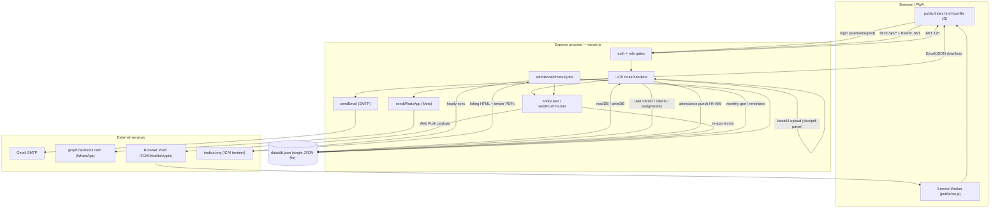
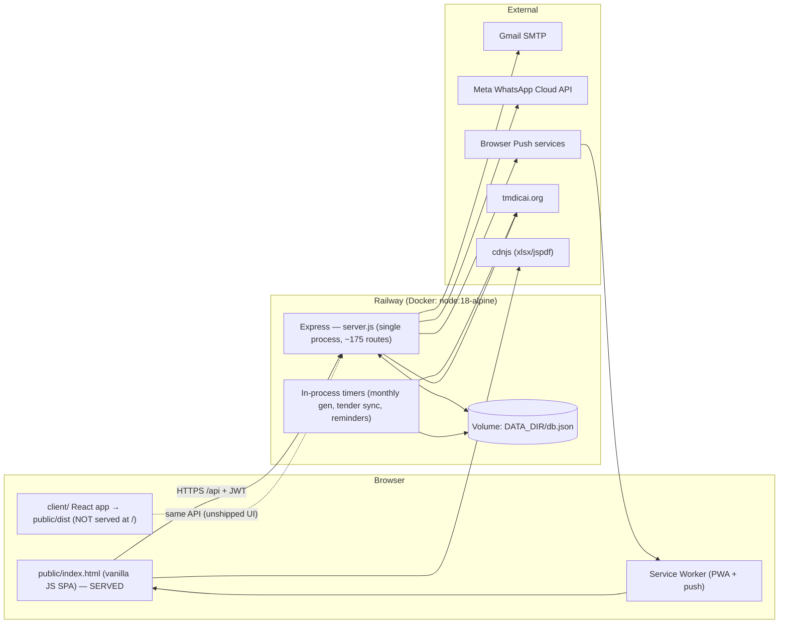
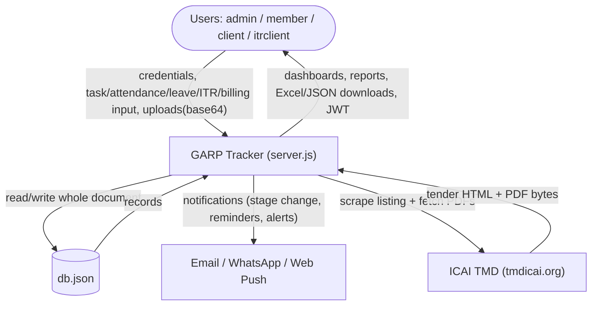
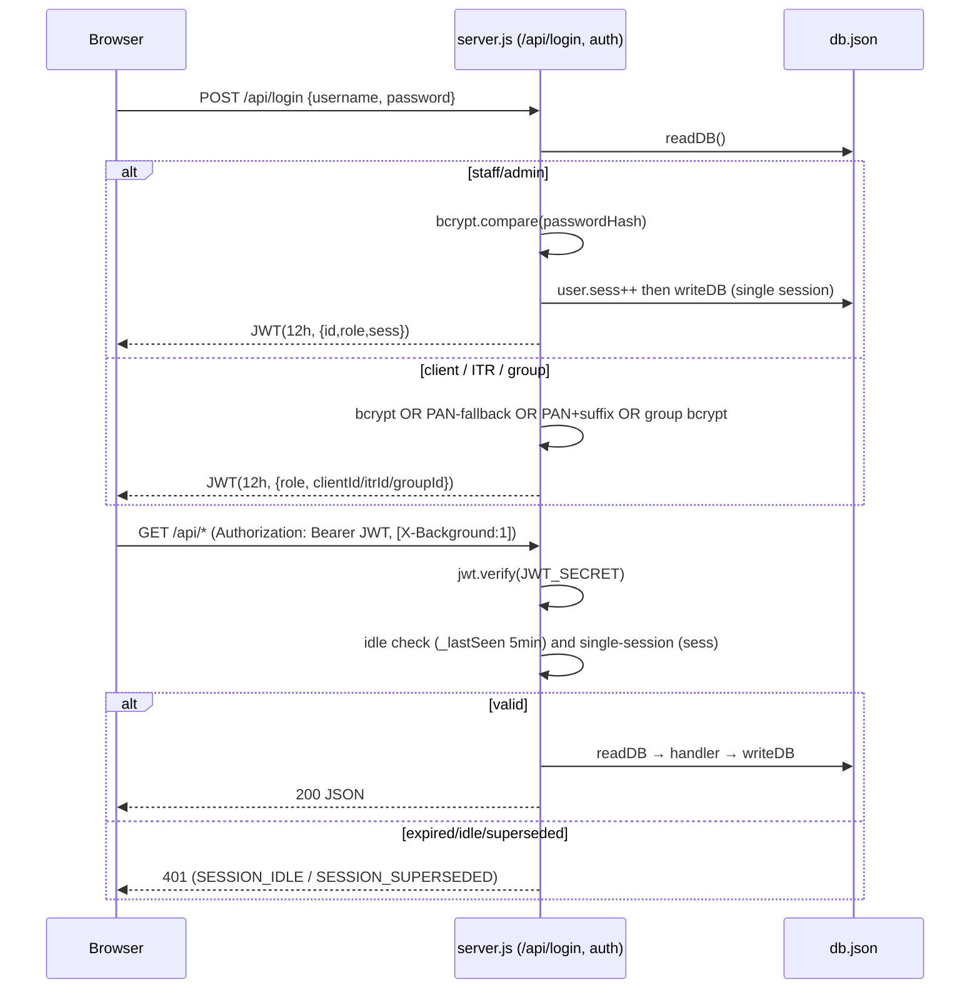
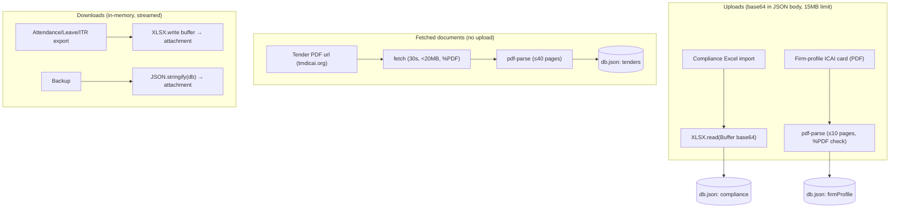
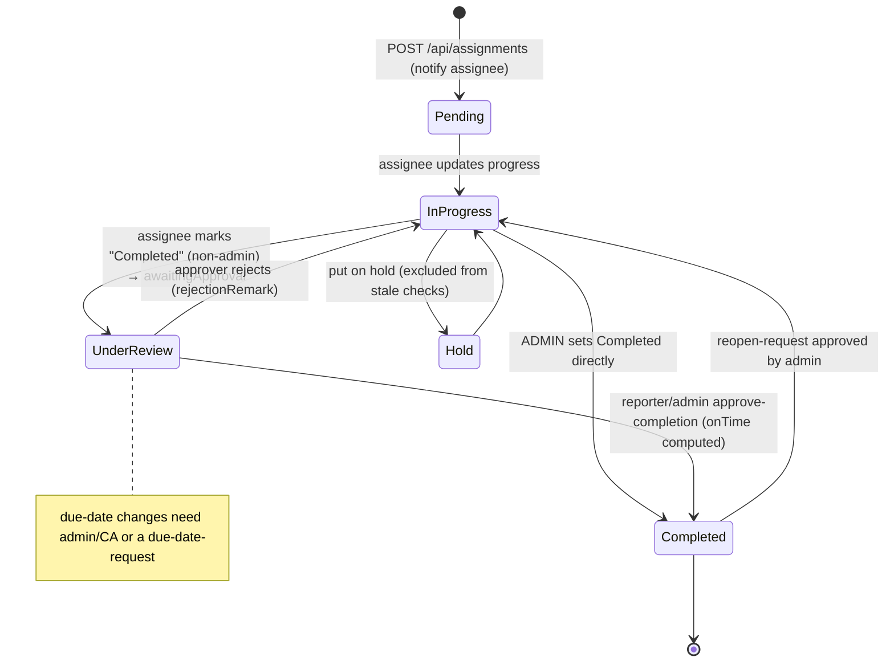
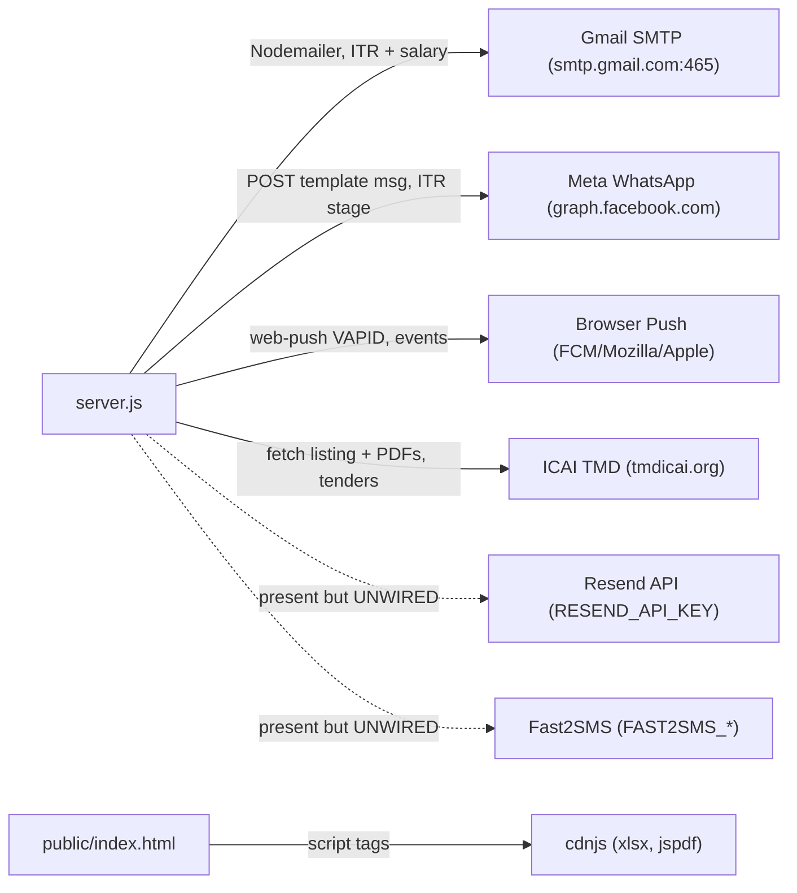

# GARP Tracker — Project Architecture &amp; Technical Analysis

> **Scope:** A code-verified technical analysis of this repository. Every claim is drawn from the source; where useful, locations are cited as `file:line`. **No secret values are reproduced** — only variable names and their purpose.
>
> **Companion document:** [`SYSTEM_ARCHITECTURE.md`](./SYSTEM_ARCHITECTURE.md) (component topology &amp; diagrams).

---

## ⚠️ Read First — Three "two-copies" facts that govern everything

The repository contains **parallel implementations**, and only one of each pair actually runs. Getting this wrong wastes hours, so it is stated up front:

1. **Backend: `server.js` is the running app.** It is a single ~6,561-line file that builds its own Express app (`server.js:102`), registers **~175 routes inline**, and is the entry point per `package.json` (`main`/`start`), `Dockerfile` (`CMD ["node","server.js"]`) and `railway.json` (`startCommand`). A **modular refactor** (`app.js`, `routes/*.routes.js`, `services/*.service.js`, `jobs/scheduler.js`, `middleware/`, `db/`, `config/`, `utils/`) exists and mirrors the same features, **but nothing requires `app.js` and `server.js` requires none of those folders** — it is not executed. *Verified:* a repo-wide grep finds no `require('./app')`, `require('./routes')`, or `dispatchNotification` in `server.js`.

2. **Frontend: the served UI is `public/index.html` (vanilla JS), not the React app.** `server.js` serves `public/` statically (`server.js:143`) with **no SPA catch-all**, so `GET /` returns **`public/index.html` — a self-contained ~756 KB vanilla-JavaScript app** (verified: 0 React/JSX signals, no `/dist/assets` references, 1,900+ inline JS signals; it calls the same `/api` backend via `fetch` + `Authorization: Bearer`). The **React app** in `client/` builds to `public/dist/` (1.4 KB shell + `assets/`), but the running server has **no route that serves it at `/`**. The most recent commit (`0deb036 "Add files via upload"`) re-uploaded the vanilla `index.html` over the earlier `"Replace old frontend with React at root URL"` commit.

3. **Notifications/email: the running app has 4 channels, not 5.** `server.js` sends **In-app + Web Push + Email (Gmail SMTP) + WhatsApp (Meta)** via its own inline helpers. **SMS (Fast2SMS) and Resend email are never called by `server.js`** — they exist only in the unused modular `services/`. The "5-channel dispatcher / 17-event templates / notification-config admin UI" described in `CLAUDE.md` belongs to the modular refactor and is **not wired into production**.

Throughout this document, **"the running app" / "live" = `server.js` + `public/index.html`.** The modular tree and React app are called out as "unwired" where relevant.

---

## 1. Complete Feature Inventory

Roles are the **API-enforced** gates in `server.js` (the real authorization). Base roles: `admin`, `member` (staff), `client` (external company portal), `itrclient` (individual tax filer). Elevated access comes from **capability delegation** (`db.delegation`), legacy flags (`itrAdmin`, `hrAdmin`, `payrollAccess`), hardcoded names, or partner designation — see §7.

> **Frontend column** lists the **React app** files (`client/src/…`, mapped by the frontend analysis) because they are per-feature and readable. Remember (Fact #2): the **live served UI is the single file `public/index.html`**, which implements all of these features in vanilla JS against the same API.

### 1.1 Authentication &amp; Identity
| Feature | What it does | Roles | Backend route(s) | React file(s) | DB |
|---|---|---|---|---|---|
| Login | Multi-identity login (staff, client, group, ITR party); issues 12h JWT | all | `POST /api/login` (`server.js:460`) | `pages/Login/Login.jsx` | `users, clients, groups, itrParties` |
| Session / profile | Returns caller profile + computed capabilities | any authed | `GET /api/me` (`:535`) | `context/AuthContext.jsx` | `users, clients, groups, itrParties` |

### 1.2 Team / Users
| Feature | What it does | Roles | Backend route(s) | React file(s) | DB |
|---|---|---|---|---|---|
| List team | All users (password hash stripped) | any authed | `GET /api/users` (`:571`) | `pages/Team/Team.jsx` | `users` |
| Create/edit/delete member | CRUD with anti-privilege-escalation; salary fields on user record | `staffOnly` create; self/HR/admin edit; `adminItrOrHr` delete | `POST/PUT/DELETE /api/users` (`:575/:602/:658`) | `pages/Team/UserForm.jsx`, `MemberProfile.jsx` | `users, auditLog` |

### 1.3 Clients &amp; Groups
| Feature | What it does | Roles | Backend route(s) | React file(s) | DB |
|---|---|---|---|---|---|
| Client CRUD | Clients with portal login (default username/pwd = PAN) | `staffOnly` create; `adminOnly` edit; `adminOrItr` delete (cascades assignments) | `/api/clients*` (`:671–802`) | `pages/Clients/*` | `clients, assignments, auditLog` |
| Group logins | One credential spanning several companies | `adminOnly` | `/api/groups*` (`:678–719`) | (in Clients) | `groups, clients` |
| Portal dashboards toggle | Which dashboards a client sees | `adminOnly` | `PUT /api/clients/:id/dashboards` (`:790`) | — | `clients` |

### 1.4 Assignments (core work tracking)
| Feature | What it does | Roles | Backend route(s) | React file(s) | DB |
|---|---|---|---|---|---|
| Task list | Scoped to assignee/reporter/sub-assigner; admin sees all | any staff | `GET /api/assignments` (`:1933`) | `pages/Assignments/Assignments.jsx` | `assignments, recurringTemplates` |
| Create / bulk-create | Task or sub-assignment; notifies assignee | any staff (inline rules) | `POST /api/assignments` (`:1979`) | `AssignmentForm.jsx` | `assignments, notifications` |
| Update (3-tier) | Admin/reporter/assignee tiers; non-admin "Completed" → Under Review | any staff (inline) | `PUT /api/assignments/:id` (`:2029`) | `AssignmentDetail.jsx` | `assignments, dueDateChangeLog, notifications` |
| Approve/reject completion | Reporter/admin approves → Completed | reporter/admin | `POST /api/assignments/:id/approve-completion` (`:2135`) | `AssignmentDetail.jsx` | `assignments, notifications` |
| Delete / bulk-delete | Admin (or sub-assigner) cascade delete | admin/sub-assigner | `DELETE /api/assignments/:id` (`:2178`), `POST /bulk-delete` (`:3054`) | `Assignments.jsx` | `assignments` |
| Comments thread | Comment/reminder; client comment pushes to staff | client/staff (inline) | `POST /api/assignments/:id/comments` (`:1624`) | `AssignmentDetail.jsx` | `assignments, pushSubscriptions` |
| Approvals hub | Completion + due-date + reopen queues | staff/admin | (aggregates above + §1.5) | `pages/Approvals/Approvals.jsx` | multiple |

### 1.5 Due-date &amp; Reopen Requests
| Feature | What it does | Roles | Backend route(s) | DB |
|---|---|---|---|---|
| Due-date change request | Reporter requests, admin approves → applies new date | reporter/admin | `/api/due-date-requests*` (`:2514–2534`), log `GET /api/due-date-log` (`:2549`) | `dueDateRequests, assignments, dueDateChangeLog` |
| Reopen request | Reopen a Completed task; admin approves → In Progress | reporter/admin | `/api/reopen-requests*` (`:2830–2859`) | `reopenRequests, assignments` |

### 1.6 Recurring / Statutory Work
| Feature | What it does | Roles | Backend route(s) | React file(s) | DB |
|---|---|---|---|---|---|
| Recurring templates | CRUD; reconciles open generated tasks to template | staff (inline) | `/api/recurring-templates*` (`:2191–2280`) | `pages/RecurringTasks/RecurringSetup.jsx` | `recurringTemplates, assignments` |
| Generate period | Manual/one-off generation | staff | `POST /api/recurring-templates/:id/generate` (`:2393`) | `RecurringSetup.jsx` | `assignments` |
| Statutory catalog / apply | Indian GST/TDS/IT/ROC/PF-ESI due-date catalog → bulk templates | `staffOnly` | `GET /api/statutory/catalog` (`:2341`), `POST /api/statutory/apply` (`:2349`) | `RecurringSetup.jsx` | `recurringTemplates, assignments, auditLog` |
| Recurring report | Month-grid heatmap of recurring tasks | staff (no clients) | `GET /api/recurring-report` (`:1899`) | `RecurringDashboard.jsx` | `assignments, clients` |
| Recurring cleanup | Prune tasks whose period no longer fits frequency | `adminOnly` | `/api/recurring-cleanup` (`:2487/:2504`) | `RecurringSetup.jsx` | `assignments` |

### 1.7 Attendance
| Feature | What it does | Roles | Backend route(s) | React file(s) | DB |
|---|---|---|---|---|---|
| Punch in/out | Records `"HH:MM"` IST; optional mobile-only + office-WiFi/IP checks; comp-off on holiday work | any staff | `POST /api/attendance/punch-in|out` (`:3276/:3329`) | `pages/Attendance/MyAttendance.jsx` | `attendance, settings, siteVisits, compOffs` |
| My / today / member history | Read own or (admin) all | self/admin | `GET /api/attendance*` (`:3381–3394`, `:5954`) | `MyAttendance.jsx` | `attendance` |
| Manual mark / remark / edit | Admin/payroll create/override records | `payrollAccess` / `adminOrHr` | `POST /mark`, `PUT /remark`, `PUT/DELETE /record` (`:3402–3499`) | `pages/Attendance/PunchStatus.jsx` | `attendance, auditLog` |
| Admin board + reports + Excel | Daily board, monthly grid, summary, XLSX | `payrollAccess` | `/api/attendance/report(.xlsx)`, `/summary`, `/today-all` (`:5878–6396`) | `PunchStatus.jsx` | `attendance, users, siteVisits, holidays, rules` |

### 1.8 Leave, Comp-off, Holidays, Site Visits
| Feature | What it does | Roles | Backend route(s) | React file(s) | DB |
|---|---|---|---|---|---|
| Leave requests (primary) | Apply/approve; on approval writes attendance rows | member apply; `adminOnly` approve | `/api/leave-requests*` (`:2887–2926`); reports `/api/leave-report(.xlsx)` (`:3020–3025`) | `pages/Leave/MyLeave.jsx` | `leaveRequests, attendance, compOffs` |
| Leave (legacy store) | Second leave store still active; balance reads this one | staff apply; `adminOnly` approve | `/api/leaves*`, `/leaves/adjust`, `/leaves/balance` (`:5498–5584`) | `MyLeave.jsx` | `leaves, attendance` |
| Comp-offs | Auto-credit on holiday work; manual grant/revoke; consumed by comp-off leave | any read; `adminOnly` write | `/api/comp-offs*` (`:5761–5794`) | (in Leave/Attendance) | `compOffs` |
| Holidays | Catalog + custom firm holidays | any read; `adminOnly` write | `/api/holidays*` (`:5652–5703`) | `pages/FirmProfile/FirmProfile.jsx` | `holidays` |
| Site visits | Log client-site visit → attendance `Site Visit` | any staff | `/api/site-visits*` (`:5976–6008`) | (client/assignment context) | `siteVisits, attendance` |

### 1.9 Salary / Payroll
| Feature | What it does | Roles | Backend route(s) | React file(s) | DB |
|---|---|---|---|---|---|
| Salary config list | Members with salary components (stored on user record) | `payrollAccess` | `GET /api/salary-config` (`:6016`) | `pages/Salary/Salary.jsx` | `users` |
| Compute slip | Attendance-driven gross/PF/ESI/net for a month | self/payroll | `GET /api/salary/:userId/:year/:month` (`:6122`) | `SalarySlip.jsx` | `users, attendance, holidays, rules, leaves` |
| Email slip(s) | Email one / all slips via SMTP | `payrollAccess` | `POST /api/salary/.../email`, `/email-all` (`:6144/:6160`) | `Salary.jsx` | `users, attendance` |

### 1.10 ITR Filing Tracker
| Feature | What it does | Roles | Backend route(s) | React file(s) | DB |
|---|---|---|---|---|---|
| Party pipeline | 5-stage ITR tracking; assign/report; comments; filing decision | itrAdmin/assigned/reporting; itrclient self-view | `/api/itr/parties*`, `/stage`, `/assign`, `/decision`, `/comments` (`:1659–1887`) | `pages/ITR/ItrDashboard.jsx` | `itrParties` |
| Stage-change notify | Email + WhatsApp to taxpayer on stage change | itrAdmin (auto) | `PUT /api/itr/parties/:id/stage` (`:1818`), `/notify*` (`:1875–1887`) | `ItrDashboard.jsx` | `itrParties` → **email + WhatsApp** |
| Bulk import / export | Bulk upsert; XLSX + print-HTML export | itrAdmin / any staff | `POST /parties/bulk` (`:1761`), `GET /export.xlsx|.pdf` (`:1684/:1714`) | `ItrDashboard.jsx` | `itrParties` |

### 1.11 Invoices, Billing &amp; Cashflow
| Feature | What it does | Roles | Backend route(s) | React file(s) | DB |
|---|---|---|---|---|---|
| Invoice register (replace) | Bulk-replace a client's invoices + banks/outflows/fixed-expenses/notes | `adminOnly` | `POST /api/clients/:id/invoices` (`:824`) | (admin billing) | `invoices, bankBalances, outflows, fixedExpenses, salesNotes` |
| Mark payment | Set `actualDate` on an invoice | any authed except `client` | `PUT /api/invoices/:invId` (`:931`) | — | `invoices` |
| Billing dashboards | Period dashboard, time series, pivot, pivot-cell drill, bank position (Indian FY) | `client` self &amp; `adminOnly` preview | `/api/(client|clients/:id)/(invoice-dashboard|period-dashboard|billing-series|billing-pivot|pivot-cell|bank-position)` (`:1002–1586`) | `pages/ClientPortal/ClientBilling.jsx` | `invoices, bankBalances, outflows, fixedExpenses, salesNotes` |

### 1.12 Compliance Tracker
| Feature | What it does | Roles | Backend route(s) | React file(s) | DB |
|---|---|---|---|---|---|
| Compliance grid | GST/TDS/PF/ESI/ITR/ROC obligations per client per FY; Excel import | `adminOnly`; `client` self-view | `/api/clients/:id/compliance*` (`:1048–1114`), `/api/client/compliance` (`:1053`) | `pages/ClientPortal/ClientCompliance.jsx` | `compliance` (object keyed by clientId) |

### 1.13 Business Development — Leads &amp; Tenders
| Feature | What it does | Roles | Backend route(s) | React file(s) | DB |
|---|---|---|---|---|---|
| Leads pipeline | Lead stages + event trail | `partnerOrAdmin` | `/api/leads*` (`:3499–3564`) | `pages/BizDev/BizDev.jsx`, `LeadForm.jsx` | `leads` |
| Tenders CRUD | Govt tender tracking + event trail | `partnerOrAdmin` | `/api/tenders*` (`:3577–3677`, `:5386–5487`) | `BizDev.jsx`, `TenderDetail.jsx` | `tenders, tenderSync` |
| ICAI TMD sync | Scrape ICAI tender listing; import; hourly auto-sync | `partnerOrAdmin` | `/api/tenders/import*`, `/sync-*` (`:3832–3855`, `:5370–5386`) | `BizDev.jsx` | `tenders, tenderSync` → **tmdicai.org** |
| Tender PDF analysis + eligibility | Fetch &amp; parse tender PDFs; judge eligibility vs firm profile | `partnerOrAdmin` | `/api/tenders/analyse*` (`:5456–5487`) | `BizDev.jsx` | `tenders, firmProfile` → **tmdicai.org PDFs** |

### 1.14 Firm Profile
| Feature | What it does | Roles | Backend route(s) | React file(s) | DB |
|---|---|---|---|---|---|
| Profile &amp; experience | Firm credentials, partners, audit-experience registry | `partnerOrAdmin` read; `adminOnly` write | `/api/firm-profile*` (`:4124–4182`) | `pages/FirmProfile/FirmProfile.jsx` | `firmProfile` |
| ICAI card parsing | Parse uploaded ICAI PDF (base64) → merge members | `adminOnly` | `POST /api/firm-profile/parse-card|apply-card` (`:4374/:4397`) | `FirmProfile.jsx` | `firmProfile` (pdf-parse) |

### 1.15 Delegation, Settings, Reports, Admin
| Feature | What it does | Roles | Backend route(s) | React file(s) | DB |
|---|---|---|---|---|---|
| Delegation of Authority | Map capabilities → users; per-role limits | `adminOnly` | `/api/delegation*` (`:4043–4113`) | (React Settings) | `delegation` |
| Office rules | Timing/leave/attendance rules (many decorative — §11) | any read; `adminOnly` write | `GET/PUT /api/rules` (`:3999/:4003`) | `pages/Settings/Settings.jsx` | `rules` |
| Settings / my-ip | Office settings (mobile-only punch, WiFi IPs), caller IP | any authed | `/api/settings` (`:6373/:6385`), `/api/my-ip` (`:6377`) | `Settings.jsx` | `settings` |
| Reports | Workload, overdue, client, performance, monthly | `adminOnly` | `/api/reports/*` (`:6446–6484`), `/performance` (`:2555`), `/monthly-report` (`:2610`) | `pages/Reports/*` | `assignments, users, clients` |
| Audit log | Filterable activity trail | `adminOnly` | `GET /api/audit-log` (`:274`) | `pages/Reports/AuditLog.jsx` | `auditLog` |
| Backup / restore | Download full DB JSON; restore (full replace, keeps audit) | `adminOnly` | `GET /api/backup` (`:6490`), `POST /api/restore` (`:6499`) | (React Settings) | entire DB |
| Health | Liveness probe | public | `GET /health` (`:6487`) | — | — |

### 1.16 Notifications (in-app + push)
| Feature | What it does | Roles | Backend route(s) | React file(s) | DB |
|---|---|---|---|---|---|
| In-app notifications | List/create/mark-read/clear | any authed | `/api/notifications*` (`:2568–2602`) | `components/Topbar.jsx` bell | `notifications` |
| Web push subscribe/test | VAPID subscribe/unsubscribe/test | any authed (key public) | `/api/vapid-public-key` (`:2697`), `/push-subscribe|test|unsubscribe` (`:2702–2745`) | (service worker `public/sw.js`) | `pushSubscriptions` |
| Celebrations | Birthday/anniversary push (once/day) | `adminOnly` trigger + hourly job | `POST /api/notify-celebrations` (`:6176`) | — | `users, sentCelebrations` |

> **Not in the running app** (React Settings page calls these, but `server.js` has **no such routes** — they exist only in the modular `routes/`): `GET/PUT /api/notification-config`, `PUT /api/notification-config/:eventKey`, `POST /api/notification-config/test`, `POST /api/holidays/seed-india`. Using the React UI against the live backend, those actions **404**.

---

## 2. System Architecture

### 2.1 Components (as they actually run)
- **Web/App server** — Node.js 18 + Express 4, single process, `server.js`. Serves the API **and** static files; no reverse proxy in-repo (Railway terminates TLS in front).
- **Served frontend** — `public/index.html`, a monolithic vanilla-JS SPA (~756 KB, inline scripts, CDN libs: `xlsx`, `jspdf`, `jspdf-autotable`). Talks to the API with `fetch('/api/…')` + `Authorization: Bearer <jwt>`, JWT in `localStorage`.
- **Parallel React frontend** — `client/` (React 19 + Vite 6 + Tailwind v4 + React Router v7) → builds to `public/dist/`. **Not served at `/`** by the running server; it uses `AuthContext`/`DataContext`, an `api()` wrapper, and mirrors the same endpoints. Treat as a second, unshipped UI.
- **Database** — a **single JSON file** `data/db.json`. `server.js` has its own synchronous `readDB()`/`writeDB()` (`:145–163`): read = `JSON.parse(fs.readFileSync)`, write = `fs.writeFileSync(JSON.stringify(db))` (no pretty-print, no locking, whole-file). `DATA_DIR` defaults to `./data`, overridden to the Railway volume in production.
- **File storage** — **none persistent.** Uploads arrive as **base64 in the JSON body** (`req.body.fileBase64`, 15 MB limit) and are parsed in memory (`xlsx`, `pdf-parse`); downloads (Excel/JSON) are generated in memory and streamed as attachments. `data/pre-restore-backups/` is the only server-written file area (`:6508`).
- **Background jobs** — plain `setInterval`/`setTimeout` inside the same process (§8). No cron, no queue, no external scheduler.
- **Authentication** — stateless JWT (12 h) + an **in-memory** idle map + a per-user session counter in the DB (§7).
- **External services** — Gmail SMTP, Meta WhatsApp Cloud API, browser Web-Push endpoints, and ICAI TMD (`tmdicai.org`) (§6).

### 2.2 How components communicate
```
Browser (public/index.html, vanilla JS)
   │  fetch('/api/…')  +  Authorization: Bearer <JWT in localStorage>
   ▼
Express (server.js, one process)
   ├─ express.json({limit:'15mb'})  →  cache-control  →  BLOCKED_PUBLIC guard  →  express.static(public)
   ├─ auth() middleware  →  role gate (adminOnly / staffOnly / payrollAccess / partnerOrAdmin / itrAdmin / …)
   ├─ handler:  readDB()  →  mutate in memory  →  writeDB()   (whole-file JSON)
   ├─ side effects:  notifyUser()/sendPushToUser()  (in-app + Web Push)
   │                 sendEmail() (SMTP)  ·  sendWhatsApp() (Meta Graph)  ·  fetch(tmdicai.org)
   └─ JSON response  (or Excel/JSON attachment)
Background timers (same process): monthly generation, tender sync, attendance/celebration/stale-remark checks
```
- **Frontend ↔ backend:** REST/JSON over HTTPS; JWT bearer header; 30 s background polling (React) or timer polling (vanilla) with `X-Background:1` so polls don't reset the idle timer.
- **Backend ↔ DB:** in-process synchronous file I/O; **every write serializes the entire DB**; the rules cache is invalidated on each write.
- **Backend ↔ external:** outbound HTTPS via Node `https`/`fetch` (WhatsApp, ICAI) and Nodemailer SMTP (email); Web Push via the `web-push` library to each subscription's endpoint.

---

## 3. Data-Flow Diagram (major flows)



---

## 4. Request Flow — worked examples

**A. Login** (`User → API → DB → JWT`)
```
POST /api/login {username,password}
 └ server.js:460  readDB()
    ├ match db.users by username  → bcrypt.compare(passwordHash)  → bump user.sess (single-session) → writeDB
    │  └ jwt.sign({id,role,…,sess}, JWT_SECRET, 12h)  → { token, user }
    └ else try client (bcrypt OR PAN==PAN) → else itrParty (pwd == PAN + fixed suffix) → else group (bcrypt)
```

**B. Assignment create** (`User → auth → handler → DB → notify`)
```
POST /api/assignments  (Bearer JWT)
 └ auth (server.js:200)  → verify JWT, idle check, single-session  → req.user
    └ handler (:1979)  readDB() → validate (sub-assignment rules) → push new assignment (Pending, completionPct:0)
       → notifyUser(memberId)  → writes db.notifications + sendPushToUser(Web Push)  → writeDB()  → 200 JSON
```

**C. Attendance punch-in** (`User → auth → rules → DB`)
```
POST /api/attendance/punch-in  (Bearer JWT)
 └ auth → handler (:3276)  readDB()
    ├ optional settings.mobileOnlyPunch (User-Agent) + settings.wifiCheckEnabled (reqIp vs officeIPs prefix)
    ├ punchIn = timeStr() "HH:MM" IST ; isLate = punchIn > rules.lateGrace (string compare)
    ├ if holiday/weekly-off work → creditCompOff(...)
    └ writeDB() → 200
```

**D. Document flow — ICAI tender PDF** (`job/API → external fetch → pdf-parse → DB`)
```
POST /api/tenders/:id/analyse  OR hourly runTenderSync()
 └ readTenderPdf(url) (:5209)  fetch('https://tmdicai.org/count1.php?pdf_id=…', UA header, 30s abort)
    → guard (<20MB, starts %PDF) → pdf-parse first 40 pages
    → extractTenderCriteria → evaluateEligibility(firmProfile) → tender.extracted/eligibility → writeDB()
```
*(Firm-profile card upload is the inverse: admin posts base64 PDF → `pdf-parse` first 10 pages → preview → apply.)*

**E. ITR stage change → Email + WhatsApp** (`API → external`)
```
PUT /api/itr/parties/:id/stage  (itrAdmin/assigned/reporting)
 └ handler (:1818)  set stage (+filedAt on "Filed") → writeDB()
    └ notifyItrStage(party) (:84):
        ├ sendEmail(party.email, …)     → Nodemailer → smtp.gmail.com:465
        └ sendWhatsApp(party.mobile, WA_TEMPLATE_STAGE, [name,ay,stage]) → POST graph.facebook.com/{ver}/{phoneId}/messages (Bearer WA_TOKEN)
```

**F. Excel export** (`API → in-memory xlsx → attachment`)
```
GET /api/attendance/report.xlsx?month&year  (payrollAccess; token via header or ?token=)
 └ build data → require('xlsx') → XLSX.write(...,'buffer') → Content-Disposition: attachment → stream
```

---

## 5. Database Storage

**Engine:** none — a single JSON document at **`DATA_DIR/db.json`** (`DATA_DIR` env, default `./data`; Railway volume in prod). Whole-file synchronous read/write; **no locking, no transactions, no indexes.** IDs are `newId()` = `Date.now().toString(36)+random` (`server.js:165`). No pretty-printing on write (`:163`).

**Top-level collections referenced by the running app** (usage counts from `server.js`):

| Collection | Holds | Key relationships |
|---|---|---|
| `users` | Staff + admin accounts, salary components, flags (`itrAdmin/hrAdmin/payrollAccess`), `sess` counter | `id` referenced by assignments/attendance/leaves/salary |
| `clients` | Client companies + portal login (`clientUsername`, `passwordHash`, PAN), `groupId`, `dashboards` | `groupId → groups.id`; `id → assignments.clientId` |
| `groups` | Group logins over multiple clients | `id → clients.groupId` |
| `assignments` | Tasks + sub-tasks, status, `activityLog`, recurring linkage | `clientId→clients`, `memberId`/`reportingPersonId`/`subAssignedBy`→users, `parentAssignmentId`→assignments, `recurringTemplateId`→recurringTemplates |
| `recurringTemplates` | Recurring task definitions (`active` boolean, `dueDayOfMonth`, `frequency`) | `clientId`, `memberId`, `reportingPersonId` |
| `dueDateRequests`, `reopenRequests` | Approval requests | `assignmentId→assignments`, `memberId/requestedBy→users` |
| `dueDateChangeLog` | Audit of due-date changes | `assignmentId` |
| `attendance` | Punch rows; `date` `"YYYY-MM-DD"`, `punchIn/Out` `"HH:MM"` (IST) | `userId→users` |
| `leaveRequests` | Primary leave store (lowercase status) | `memberId→users` |
| `leaves` | **Legacy** leave store (balance reads this) | `userId→users` |
| `compOffs` | Comp-off credits/consumption | `userId→users` |
| `holidays` | Firm holidays (custom + selected catalog) | by date |
| `siteVisits` | Client-site visit logs | `userId`, `clientId` |
| `salaryConfig` | (Mostly unused — salary lives on `users`) | — |
| `itrParties` | ITR taxpayers; each is also an `itrclient` login | `assignedTo`/`reportingTo→users` |
| `invoices` | Per-client invoice register | `clientId→clients` |
| `bankBalances`, `outflows`, `fixedExpenses`, `salesNotes` | Cashflow inputs (bank position, credit/debit notes) | `clientId→clients` |
| `compliance` | **Object keyed by clientId** → array of obligation records (FY/period/obligation/GSTIN) | key = clientId |
| `leads` | BizDev leads + event trail | `partnerId→users` |
| `tenders`, `tenderSync` | Govt tenders + sync metadata | `partnerId→users` |
| `firmProfile` | Firm credentials, `members[]`, `experience[]`, `autoSync` | singleton object |
| `delegation` | `grants{capability→[userIds]}`, `limits[]` | userIds→users |
| `rules` | Office rules (merged over `DEFAULT_RULES`) | singleton object |
| `settings` | Office settings (mobile-only punch, WiFi/office IPs) | singleton object |
| `notifications` | In-app notifications | `userId→users` |
| `pushSubscriptions` | Web-Push subscriptions | `userId→users` |
| `auditLog` | Activity trail (capped 5,000, `:240`) | `actorId→users` |
| `sentCelebrations`, `sentAttnReminders`, `staleRemarkLog` | Job de-dup keys | — |

See `SYSTEM_ARCHITECTURE.md` for an ER-style diagram.

---

## 6. External Services

| # | Service | Host / transport | Trigger | Data **sent** | Data **received** | Env vars |
|---|---|---|---|---|---|---|
| 1 | **Email — Gmail SMTP** | `smtp.gmail.com:465` via Nodemailer (`server.js:22–48`) | ITR stage change / notify-test; salary slips | `to`, subject, text/HTML body (ITR text carries no financial figures; **salary slips do contain salary figures**) | SMTP send result | `SMTP_USER, SMTP_PASS, SMTP_HOST, SMTP_PORT, MAIL_FROM` |
| 2 | **WhatsApp — Meta Cloud API** | `https://graph.facebook.com/{WA_API_VERSION}/{WA_PHONE_ID}/messages` (`server.js:57–82`) | ITR stage change / notify-test | template message `{name, language, body params [name, ay, stage]}`, `Authorization: Bearer <WA_TOKEN>`; recipient normalized to E.164 (+91) | HTTP status | `WA_TOKEN, WA_PHONE_ID, WA_API_VERSION, WA_TEMPLATE_STAGE, WA_TEMPLATE_LANG` |
| 3 | **Web Push (VAPID)** | Each subscription's push endpoint (FCM/Mozilla/Apple) via `web-push` (`server.js:2753`) | Assignment/leave/tender/attendance/celebration events | Encrypted payload `{title, body, tag, url}` | 201/404/410 (dead subs pruned) | `VAPID_PUBLIC, VAPID_PRIVATE` |
| 4 | **ICAI TMD — listing** | `https://tmdicai.org/Opportunities.php` via `fetch` (`server.js:3818`) | Manual preview / `sync-now` / hourly + 90 s-after-boot | Request headers only (`User-Agent: GARP-Tracker/1.0`) | Public tender-listing HTML (scraped) | — |
| 5 | **ICAI TMD — PDFs** | `https://tmdicai.org/count1.php?pdf_id=…` (tender `pdfUrl`) via `fetch` (`server.js:5209`) | Tender analyse / analyse-all / auto-sync | Request headers only | Tender PDF bytes (parsed by `pdf-parse`, ≤40 pages, ≤20 MB, must start `%PDF`) | — |
| — | **CDN (client runtime)** | `cdnjs.cloudflare.com` — `xlsx`, `jspdf`, `jspdf-autotable` `<script>` in `public/index.html` | Page load | — (static asset fetch) | JS libraries | — |

**Present in the repo but NOT called by the running app:** Resend (`services/resend-email.service.js`, `RESEND_API_KEY`), Fast2SMS (`services/sms.service.js`, `FAST2SMS_*`). Android TWA Digital Asset Links (`/.well-known/assetlinks.json`, `server.js:120`) is served but inert unless `ANDROID_PACKAGE`/`ANDROID_SHA256` are set.

---

## 7. Authentication &amp; Authorization

### 7.1 Login &amp; identities (`POST /api/login`, `server.js:460`)
Four identity types are tried in order, all returning a **12-hour JWT** signed with `JWT_SECRET`:
1. **Staff/admin** — match `db.users.username`, `bcrypt.compare(passwordHash)`; legacy plaintext `password` auto-migrated to hash; **`user.sess` counter incremented** on every login (single active session).
2. **Client** — match `clientUsername` or PAN; `bcrypt.compare` **OR PAN-as-password fallback** (username=PAN, password=PAN) for legacy clients.
3. **ITR party** — match PAN; password must equal the **PAN plus a fixed hardcoded suffix** (`server.js:512`; the literal suffix is not reproduced here).
4. **Group** — match `groupUsername`, `bcrypt.compare`; token carries `isGroup:true`, `groupId`.

### 7.2 Tokens &amp; sessions
- **JWT payload:** `{id, username, name, role, …, sess}` for staff; `clientId` / `itrId` / `groupId` for the others. 12 h absolute expiry.
- **Idle timeout:** in-memory `_lastSeen` Map, `IDLE_LIMIT_MS = 5 min` (`server.js:192`). A request older than 5 min → `401 SESSION_IDLE`. Requests with header **`X-Background:1` do not refresh** the timer (so polling can't keep a session alive). *Because the map is in-process, it resets on restart and is not shared across instances.*
- **Single session:** JWT `sess` must equal `db.users[x].sess`, else `401 SESSION_SUPERSEDED` (`:217`).
- **Passwords:** `bcryptjs`, cost 10. Hashes stripped from all user/client responses.

### 7.3 Roles &amp; capabilities (the real model)
Authorization is a **hybrid**: base role + **Delegation-of-Authority** capabilities + legacy flags + hardcoded names + partner designation.
- **`auth`** (`:200`) — required on all `/api/*` except `/api/login`, `/api/vapid-public-key`, `/health`, `/.well-known/assetlinks.json`.
- **`adminOnly`** (`:230`) — passes for `admin`, **or** for a user granted the route's mapped capability. `ROUTE_CAPS` (`:381`) maps path→capability (e.g. `/api/clients`→`clients.manage`, `/api/tenders`→`bd.manage`); `can()` (`:366`) checks `db.delegation.grants`. Unmapped admin routes stay strictly admin.
- **Capability set** `CAPABILITIES` (`:328`, 15 keys): `team.manage, salary.view, payroll.run, attendance.manage, leave.approve, clients.manage, tasks.manageAll, recurring.manage, itr.manage, bd.manage, firmprofile.manage, reports.view, rules.manage, backup.manage, delegation.manage`.
- **Legacy flags &amp; hardcoded names:** `itrAdmin` (or name **"annpurna"**) → ITR admin (`:298`); `hrAdmin` (or name **"meenu jha"**) → HR admin (`:417`); `payrollAccess`/`hrAdmin` → payroll (`:403`); `designation` contains **"partner"** → BizDev (`:374`). A one-time `getDelegation()` migration seeds grants from these flags until an admin saves the Delegation screen.
- **Other gates:** `staffOnly` (blocks client/itrclient), `adminOrItr`, `adminItrOrHr`, `adminOrHr`, `payrollAccess`, `partnerOrAdmin`, plus `clientScope()` (`:449`) which limits a client/group token to its own/member client IDs.

### 7.4 Protected routes
All state-changing routes are behind `auth` + a role gate (see §1 tables). **Public (no auth):** `POST /api/login`, `GET /api/vapid-public-key`, `GET /health`, `GET /.well-known/assetlinks.json`. **Frontend note:** the React app's `RequireAuth` guards *authentication only* — page authorization is by nav visibility + in-component checks; the API gates are the real enforcement.

---

## 8. Background Jobs (all in-process, `server.js`)

| Job | Schedule | What it does | Line |
|---|---|---|---|
| Idle-session cleanup | every 10 min | Drops stale `_lastSeen` entries | `:195` |
| **Monthly recurring generation** | 00:05 on the 1st of each month (self-rescheduling `setTimeout`) + once at boot | `runMonthlyGeneration()` creates the period's tasks for every `active` template | `:6548`/`:6535`, `:2445` |
| **ICAI tender sync** | every 1 h + 90 s after boot | `runTenderSync()` scrapes ICAI listing, imports new tenders, reads ≤5 PDFs, pushes alerts for new *Eligible* tenders (honors `firmProfile.autoSync`) | `:5366`/`:5367`, `:5289` |
| Celebrations | every 1 h (sends each event once/day) | Birthday/anniversary Web-Push to all users | `:6214` |
| Stale-remark check | every 1 h + 15 s after boot | Flags tasks idle ≥2 days; notifies once/day | `:6246`/`:6247` |
| **Attendance reminders** | every 5 min + 20 s after boot | After `ATTENDANCE_CUTOFF` (default 10:00), push/in-app to unmarked members + admin roll-up | `:6292`/`:6293`, `:6251` |
| Site-visit backfill | once, 8 s after boot | Reconcile site visits into attendance | `:6325` |
| Legacy-leave migration | once, 9 s after boot | Copy `db.leaves` → `db.leaveRequests` (non-destructive) | `:6369` |

No external scheduler/queue; if the process restarts, timers restart and boot-time one-shots re-run.

---

## 9. Deployment

- **Container** — `Dockerfile`: `node:18-alpine`, `npm install --production`, `COPY . .` (ships `public/index.html`, `public/dist/`, and `client/` source alike), `mkdir -p /data`, `EXPOSE 3000`, `CMD ["node","server.js"]`.
- **Platform** — Railway. `railway.json`: `builder: DOCKERFILE`, `startCommand: "node server.js"`, `restartPolicyType: ON_FAILURE` (max 10 retries). Project `stellar-gentleness` (per `CLAUDE.md`). Railway sets `PORT` (commonly 8080); app binds `0.0.0.0`.
- **Persistence** — a Railway **volume** mounted for the DB; set `DATA_DIR` to that mount so `db.json` survives redeploys. `data/` is gitignored, so the DB is not in the image — `initDB()` seeds a fresh DB with a **default admin account** (username + seed password set in `initDB`, `server.js:6538`; change it immediately — value not reproduced here) if none exists.
- **Frontend build** — React is **pre-built and committed** to `public/dist/` (Docker does not run Vite). *But per Fact #2 the running server serves `public/index.html`, not `public/dist`.*
- **Deploy trigger** — push to `main` auto-deploys (GitHub integration); `railway up` for manual.
- **No AWS/Kubernetes/Terraform** config is present in the repo.

---

## 10. Environment Variables (names only — never print values)

| Variable | Used for | Referenced |
|---|---|---|
| `PORT` | HTTP listen port (default 3000; Railway sets it) | `server.js:103` |
| `JWT_SECRET` | JWT signing secret | `server.js:104` (**hardcoded fallback present** — §11) |
| `DATA_DIR` | Directory for `db.json` (+ pre-restore backups) | `server.js:105` |
| `VAPID_PUBLIC`, `VAPID_PRIVATE` | Web-Push VAPID keypair | `server.js:10–12` (**hardcoded fallback present**) |
| `SMTP_USER`, `SMTP_PASS`, `SMTP_HOST`, `SMTP_PORT` | Gmail SMTP transport (Nodemailer) | `server.js:24–32` |
| `MAIL_FROM` | Email "From" address | `server.js:48` |
| `WA_TOKEN`, `WA_PHONE_ID`, `WA_API_VERSION`, `WA_TEMPLATE_STAGE`, `WA_TEMPLATE_LANG` | Meta WhatsApp Cloud API auth + template | `server.js:57–93` |
| `ATTENDANCE_CUTOFF` | Time-of-day for attendance reminders (default 10:00) | attendance job |
| `ANDROID_PACKAGE`, `ANDROID_SHA256` | Android TWA Digital Asset Links | `server.js:121–122` |
| `RESEND_API_KEY` | Resend email — **only in unused `services/` + `config/`**, not called by `server.js` | `config/index.js`, `services/*` |
| `FAST2SMS_API_KEY`, `FAST2SMS_SENDER_ID`, `FAST2SMS_ROUTE` | Fast2SMS — **only in unused `services/` + `config/`** | `config/index.js`, `services/sms.service.js` |

The frontend references **no** build-time env vars (`client/` has no `import.meta.env.*`/`VITE_*` usage).

---

## 11. Important Risks &amp; Issues (read before modifying)

**Architecture / "which copy is live"**
1. **Editing the modular tree or React app changes nothing in production.** The live behavior is `server.js` + `public/index.html` (Facts #1, #2). The React Settings page even calls `/api/notification-config*` and `/api/holidays/seed-india`, which **don't exist** in `server.js` (they 404).
2. **Duplicated logic can drift:** FY/billing math exists both inline in `server.js:1221–1588` and in the unused `services/invoice.service.js`; notification templates/dispatcher likewise. Fixing one won't fix the other.
3. **Duplicate route:** `PUT /api/users/:id` is registered twice (`:602` and `:6416`); Express uses the first, so `:6416` is dead code — and it calls `require('bcrypt')` (project uses `bcryptjs`), which would throw if ever reached.

**Secrets / configuration**
4. **Hardcoded fallback secrets** ship in source: a fallback `JWT_SECRET` (`server.js:104`) and a fallback VAPID keypair (`server.js:10–11`). If the env vars aren't set in production, these known-in-git values are used — anyone with the repo could forge JWTs. **Set real `JWT_SECRET`/`VAPID_*` in Railway and rotate.** (Values are intentionally not reproduced here.)
5. **Data at rest is plaintext JSON** with no encryption and **no file locking** — concurrent writes can interleave/lose data (whole-file `writeFileSync`); the design is single-instance only (also implied by the in-memory idle map). Do not scale to multiple instances without replacing the store.

**AuthN / AuthZ**
6. **Weak client/ITR credentials by design:** client login accepts the **PAN as the password** (`:497`); the ITR login password is the **PAN plus a fixed hardcoded suffix** (`:512`). PANs are low-entropy and often known to third parties, so both schemes are effectively guessable. (Literals intentionally omitted.)
7. **Over-broad reads:** `GET /api/users` (`:571`) and `GET /api/clients` (`:671`) are gated by `auth` only — **any** authenticated principal (including `client`/`itrclient`) can list all staff (names, designations, emails, mobiles) and all clients (hashes stripped).
8. **Weakly-gated invoice write:** `PUT /api/invoices/:invId` (`:931`) only blocks `role==='client'`; any other authenticated user can set an invoice's payment date, unlike the `adminOnly` invoice-register write.
9. **Authorization tied to a person's name:** hardcoded `"annpurna"`→itrAdmin and `"meenu jha"`→hrAdmin (`:302/:421`). Renaming those users silently changes access.

**Business-logic correctness**
10. **Two live leave stores** (`db.leaveRequests` primary, `db.leaves` legacy). `getLeaveBalance()` counts "used" **only** from legacy `db.leaves` with `type==='Paid'` — leaves applied via the primary flow (Casual/Sick/Earned) **don't decrement the balance** (`:3261` vs `:2897/:2937`). `migrateOldLeaves` copies but doesn't delete, so both coexist.
11. **Decorative rules:** many `db.rules` fields are edited in Settings but **never enforced** in code (verified): `lunchStart/lunchEnd, lateMarksPerHalfDay, carryForwardMax, leaveNoticeDays, maxConsecutiveLeave, sandwichRule, compOffExpiryDays`, and the notice-period fields. Changing them has no effect.
12. **Unclamped payroll deduction:** `absentDays = workingDays − actualPresent` is not clamped (`:6046`); if recorded present/paid days exceed computed working days, the absence deduction goes negative and **inflates net pay**.

**Operational / dependency**
13. **Web scraping fragility:** tender import depends on regex-parsing ICAI's HTML (`tmdicai.org`) and PDF layouts; any site change silently breaks import/eligibility. Calls have 20–30 s timeouts but no retry/backoff.
14. **`multer` is a dependency but unused** in the running paths (uploads are base64-in-JSON, capped by the 15 MB body limit); large base64 uploads inflate memory.
15. **No automated tests, linter, or type checking**; a single 6,561-line file concentrates risk and merge conflicts. The audit log is capped at 5,000 entries (older entries drop).
16. **`GET /health` is public** and returns a timestamp only (fine), but `express.static(public)` serves everything under `public/` — the `BLOCKED_PUBLIC` guard (`:135`) is what prevents `/server.js`, `/.env*`, `/data/*` from being downloadable; keep that guard intact.

---

## 12. Diagrams

### A. High-level system architecture


### B. Level-0 Data-Flow Diagram


### C. Authentication flow


### D. Document upload / data flow


### E. Assignment workflow (status lifecycle)


### F. External services / integrations


---

*Generated from a direct reading of the repository. Where this document and `CLAUDE.md` disagree (email provider, channel count, served frontend, notification-config API), this document reflects what `server.js` actually does.*
